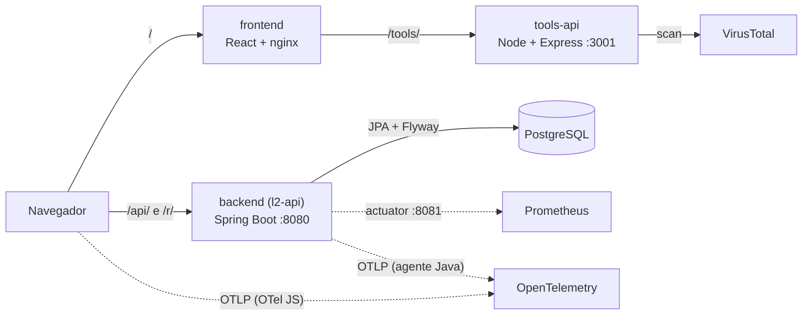

<h1 align="center">portal-app</h1>
<p align="center">
  O código do <strong>Lumi Links</strong> (Portal dos Links): um encurtador de links com a Lumi, uma
  guardiã que confere o caminho antes de cada travessia. Frontend React, API Spring Boot e uma
  API de ferramentas, com testes, imagens escaneadas e entrega GitOps.
</p>

<p align="center">
  
  
  
  
  
  
  <br>
  
  
  
  
  
  
  
</p>

Este repositório é o **código**; quem o põe para rodar em Kubernetes é o
[`portal-gitops`](https://github.com/MeloJu/portal-gitops). A fronteira é simples: um commit aqui
passa nos testes, vira três imagens escaneadas no GHCR e abre um PR no `portal-gitops` trocando a tag.
Nenhum job daqui fala com o cluster.

Cada decisão de arquitetura está documentada com o raciocínio por trás dela; a parceria com o Claude
(decisões, conversas e erros) está registrada em
[`portal-gitops/docs/uso-do-claude.md`](https://github.com/MeloJu/portal-gitops/blob/main/docs/uso-do-claude.md).

## 🎯 O produto

O Lumi Links fala uma linguagem própria, que é o que dá identidade a ele:

| Termo | O que é |
| --- | --- |
| **Lumi** | A mascote e guardiã: confere o caminho antes de seguir |
| **Portal** | O link curto |
| **Viagem** | Um clique no portal (contada, com país quando há GeoIP) |
| **Travessia** | A tela pública que mostra o destino antes de seguir |
| **Ameaça** | Um evento bloqueado (limite de taxa, URL inválida), exibido no painel de Proteção |

Estados de um portal: `ACTIVE`, `PAUSED`, `CLOSED`. Um portal pode ter validade e limite de viagens.

O que existe: cadastro e login (sessão em cookie `HttpOnly`), portais com alias, redirecionamento `302`
sem vazar o código para o destino, painel (viagens, top portais, países), painel de **Proteção** com as
ameaças bloqueadas, expansão de links encurtados e análise do destino pelo VirusTotal. As telas de
Conquistas e Configurações ainda usam dados de exemplo (não há rotas no backend para elas).

## 🏗️ Arquitetura



O front fala com a API **pela mesma origem** (o Vite em desenvolvimento e o nginx na imagem repassam
`/api/`, `/r/` e `/tools/`): o cookie de sessão funciona sem CORS. O Actuator fica numa porta separada
(8081), nunca no Ingress.

| Pasta | Stack | Docs |
| --- | --- | --- |
| [`frontend/`](frontend/README.md) | React 19, Vite 8, Tailwind v4, React Router 7, testes com Vitest e E2E com Playwright | `frontend/README.md` |
| [`backend/`](backend/) | Spring Boot 4.1 / Java 21, PostgreSQL via JPA e Flyway, JWT em cookie, Bucket4j | [`backend/docs/SECURITY.md`](backend/docs/SECURITY.md), [`docs/openapi.yaml`](docs/openapi.yaml) |
| [`tools-api/`](tools-api/) | Node 22 + Express 5: expande links e faz proxy do VirusTotal | `tools-api/.env.example` |
| [`extension/`](extension/) | Extensão Chrome/Edge (MV3): leva o link revelado no bypass.city para a Lumi | `extension/README.md` |

## 📦 Dependências e versões

| Item | Versão | Papel |
| --- | --- | --- |
| Spring Boot | 4.1.1 | backend |
| Java (JDK/JRE) | 21 (`eclipse-temurin:21-jre-noble`) | runtime da API |
| React · React Router | 19 · 7 | frontend |
| Vite · Tailwind CSS · TypeScript | 8 · 4 · 5.7 | build e estilo |
| Node | 22 (`node:22.12.0-alpine` no build do front) | frontend e tools-api |
| nginx | 1.29 (`nginx-unprivileged`) | serve o front na imagem, sem root |
| Express · Playwright | 5 · 1.49 (tools-api) / 1.64 (E2E) | tools-api e testes |
| OpenTelemetry | agente Java 2.32.0 · OTel JS 2.12 | traces da API e do navegador |
| PostgreSQL | 18 (no cluster) | banco, migrado pelo Flyway |

## 🚀 Como rodar

### Backend

Escolha uma das opções. Ambas criam o `.env` se faltar, geram um `JWT_SECRET` e um `APP_CODE_PEPPER`, sobem o PostgreSQL pelo
Docker Compose, esperam o healthcheck e iniciam a API.

**Opção A: Docker** (sem Java instalado; a primeira execução demora por causa do build)

```bash
./scripts/dev-backend-docker.sh        # PowerShell: .\scripts\dev-backend-docker.ps1
```

**Opção B: Java 21 local** (mais rápido para desenvolver)

```bash
./scripts/dev-backend.sh               # PowerShell: .\scripts\dev-backend.ps1
```

> **Por que usar os scripts?** O Spring Boot **não** lê o `.env`; quem o interpreta é o Docker Compose.
> Rodar `./mvnw spring-boot:run` direto deixa `DB_URL` vazio e dá `'url' must start with "jdbc"`. Os
> scripts carregam as variáveis no processo. O backend exige `JWT_SECRET` e `APP_CODE_PEPPER` com ao menos
> 256 bits cada e falha ao iniciar se algum faltar.

### Frontend e tools-api

Cada um em um terminal.

```bash
cd frontend && npm install && npm run dev        # http://localhost:5173
```

```bash
cd tools-api && cp .env.example .env             # preencha VT_API_KEY
npm install && npm run dev                       # http://localhost:3001
```

O Vite encaminha `/api/*` e `/r/*` para a API (8080) e `/tools/*` para a tools-api (3001). Confira:
`curl -i http://localhost:5173/api/me` deve responder `401`.

O link curto é `{PUBLIC_BASE_URL}/{code}` e abre a **Travessia**; por isso, em desenvolvimento,
`PUBLIC_BASE_URL` aponta para o Vite. O `/r/{code}` é outra coisa: um redirect `302` direto do backend.
O backend recusa destino no próprio host (`SELF_LOOP`), então use um domínio externo, como `https://example.com`.

### Cookie em HTTP local

O cookie de sessão é `Secure` por padrão. Para testar a API em HTTP, ponha `SESSION_COOKIE_SECURE=false`
no `.env`. **Nunca desabilite isso em produção.**

### E-mail em desenvolvimento

Com `MAIL_ENABLED=false` (o padrão em dev e nos testes) nada sai pela rede: o `LoggingEmailSender` escreve
destinatário, assunto e corpo no log. Para enviar de verdade, ponha `MAIL_ENABLED=true` e preencha
`MAIL_FROM`, `SMTP_HOST`, `SMTP_PORT`, `SMTP_USER` e `SMTP_PASSWORD` (`SMTP_STARTTLS=true` na porta 587).
O envio é assíncrono e falha sem derrubar a requisição: o erro vira um `WARN` sem corpo, código ou token.
Nos testes, importe `TestEmailConfiguration` para capturar as mensagens no `RecordingEmailSender`.

## 🧪 Como testar

| O quê | Comando |
| --- | --- |
| Frontend (Vitest) | `cd frontend && npm test` |
| Backend (JUnit + Testcontainers) | `cd backend && ./mvnw verify` |
| tools-api | `cd tools-api && npm test` |
| **E2E** (Playwright, stack real) | `docker compose up -d db && cd frontend && npx playwright install chromium && npm run e2e` |
| Segredos fora do Git | `scripts/check-config-secrets.sh .` |

O E2E sobe o backend e o Vite do próprio checkout, com rate limit desligado e um `JWT_SECRET` gerado na
hora. As portas `5173`, `8080` e `8081` precisam estar livres. Se falhar no CI, os traces do Playwright
ficam no artefato `playwright-traces`. Antes de um PR que mexa em sessão, portais, Travessia ou Proteção,
siga o [roteiro manual](docs/integracao/roteiro-manual.md) (dez passos no navegador).

### API

O contrato está em [`docs/openapi.yaml`](docs/openapi.yaml) e a documentação interativa em
<http://localhost:8080/swagger-ui.html>. Para o Postman, importe `postman/` ou o `openapi.yaml`.

### tools-api

- **`POST /tools/unshorten`**: segue os redirecionamentos e identifica o destino final, com proteção
  contra SSRF. Um navegador headless (`BROWSER_RESOLVER=on`) e um serviço externo (`BYPASS_API_URL`) são
  opcionais. Não resolve captcha.
- **`POST /tools/scan`**: encaminha ao VirusTotal. A chave (`VT_API_KEY`) fica **só no servidor**, nunca no front.

## 🐳 Imagens e deploy

```bash
cd backend && docker build -t l2-api:dev .
docker run --rm -p 8080:8080 -p 8081:8081 --read-only --tmpfs /tmp \
  -e DB_URL=jdbc:postgresql://host.docker.internal:5432/lumi -e DB_USER=lumi -e DB_PASSWORD=lumi \
  -e PUBLIC_BASE_URL=http://localhost:8080 -e JWT_SECRET="$(openssl rand -base64 32)" \
  -e APP_CODE_PEPPER="$(openssl rand -base64 32)" l2-api:dev
curl http://localhost:8081/actuator/health      # {"status":"UP"}
```

A imagem roda como o usuário `1001`, com sistema de arquivos somente leitura e `/tmp` gravável. O agente
OpenTelemetry vai anexado e **desligado** por padrão (`OTEL_SDK_DISABLED=false` e
`OTEL_EXPORTER_OTLP_ENDPOINT` o ligam).

O workflow `images.yml` constrói as três imagens, escaneia com o Trivy (`CRITICAL` com correção barra) e
publica no GHCR:

- `ghcr.io/meloju/portal-app-backend`
- `ghcr.io/meloju/portal-app-frontend`
- `ghcr.io/meloju/portal-app-tools-api`

Em PR as imagens só são construídas e escaneadas. As tags são `sha-<7 do commit>` (imutável, é a que vai
para o cluster) e o nome da branch.

### E-mail e segredos de produção

| Variável | Para quê | Obrigatória |
|---|---|---|
| `APP_CODE_PEPPER` | pepper dos códigos de verificação, ao menos 256 bits (`openssl rand -base64 32`) | sim; a app não sobe sem ele |
| `MAIL_ENABLED` | liga o envio de e-mail (`false` por padrão) | não |
| `MAIL_FROM` | remetente | com e-mail ligado |
| `SMTP_HOST`, `SMTP_PORT`, `SMTP_USER`, `SMTP_PASSWORD` | servidor SMTP | com e-mail ligado |

No cluster, `APP_CODE_PEPPER`, `SMTP_USER` e `SMTP_PASSWORD` entram no Secret `l2-secrets` do
`portal-gitops` (`apps/l2`), selado, e chegam ao Deployment da API por `secretKeyRef`, chave a chave.
`MAIL_ENABLED`, `MAIL_FROM`, `SMTP_HOST` e `SMTP_PORT` não são secretos e vão no ConfigMap `l2-config`.
Esses valores **não vão ao Git** deste repositório: aqui só existe o `.env.example`, com valores vazios.

### Do commit ao cluster

1. **Actions → CI**: os testes rodam; o job `images` só começa se **todos** passarem.
2. **GHCR**: as três imagens aparecem com a tag `sha-…`.
3. **`portal-gitops`**: um PR `chore(release): portal-app sha-…` troca a tag no overlay `local`, com
   **auto-merge**: entra sozinho quando os checks de lá passam. Nada pula a proteção de branch.
4. **ArgoCD** (local, que segue a `develop`) atualiza o cluster. A nuvem só recebe a versão num PR de
   release para a `main` do `portal-gitops`, que promove as imagens de propósito.

```bash
kubectl -n argocd get applications            # l2-local: Synced / Healthy
kubectl -n l2 get deploy -o wide              # a coluna IMAGES mostra a tag nova
```

O PR de bump usa o secret `GITOPS_TOKEN`, um token fine-grained **só** para o `portal-gitops`, com
*Contents* e *Pull requests* em *Read and write*. Se o PR não aparecer, o erro costuma estar aí.

## 🔐 Segurança

As decisões e os riscos aceitos estão em [`backend/docs/SECURITY.md`](backend/docs/SECURITY.md). Em resumo:

- **Acesso sempre por dono** (`findByCodeAndOwnerId`): link de outro usuário responde **404, não 403**
  (o 403 confirmaria que o código existe). Tem teste de integração dedicado contra IDOR.
- **Destino só `http`/`https`**; redirecionamento sem vazar o código; sem destino no próprio host.
- **Sessão**: JWT em cookie `HttpOnly`, 8 h, sem refresh; senhas com hash; **CORS: nenhum** (mesma origem).
- **Rate limit** por IP, rota e pod (Bucket4j); a recusa vira evento de **Ameaça** no painel.
- **Actuator fora da internet** (porta 8081); nada sensível em log nem em trace.
- **Usuário do banco sem superuser**; contêiner não-root com sistema de arquivos somente leitura.
- **Segredos fora do Git** (`scripts/check-config-secrets.sh` e `gitleaks` no CI).
- **tools-api com proteção contra SSRF**; a rede do cluster só deixa ela sair para IP público.

## 📚 Documentação

| Documento | Conteúdo |
| --- | --- |
| [`docs/openapi.yaml`](docs/openapi.yaml) | O contrato da API |
| [`backend/docs/SECURITY.md`](backend/docs/SECURITY.md) | 13 decisões de segurança e os riscos aceitos |
| [`backend/docs/GEOIP.md`](backend/docs/GEOIP.md) | País da Viagem (GeoIP é opcional e usa uma base MaxMind) |
| [`docs/integracao/roteiro-manual.md`](docs/integracao/roteiro-manual.md) | Roteiro de teste manual: do cadastro ao portal fechado |
| [`frontend/README.md`](frontend/README.md) | Scripts, estrutura, Docker e a telemetria do navegador |
| [`portal-gitops`](https://github.com/MeloJu/portal-gitops) | Kubernetes, ArgoCD, observabilidade, Terraform e a nuvem |

## 📁 Estrutura do repositório

```
portal-app/
├── 📂 backend/               # Spring Boot (API, Flyway, testes) + docs/
├── 📂 frontend/              # React + Vite (src/, e2e/, docker/)
├── 📂 tools-api/             # Node + Express (unshorten e scan)
├── 📂 extension/             # extensão Chrome/Edge (MV3)
├── 📂 docs/                  # openapi.yaml e roteiro manual
├── 📂 postman/               # coleções
├── 📂 scripts/               # dev-backend*.sh/.ps1 e check-config-secrets.sh
├── 📂 .github/workflows/     # ci.yml e images.yml
└── 📄 docker-compose.yml     # PostgreSQL de desenvolvimento
```

## ⚙️ CI/CD

- **`ci.yml`** (push e PR para `develop`/`main`): seis jobs independentes: `frontend`, `backend`,
  `tools-api`, `config-secrets`, `gitleaks` e `e2e` (Playwright com o Postgres como serviço).
- **`images.yml`** (chamado pelo `ci.yml` só quando tudo passa): matriz de 3 imagens, Trivy, publicação
  no GHCR e, num push em `develop`, o PR de bump no `portal-gitops`.

As imagens são publicadas por **digest** além da tag, e o bump grava os dois.

## 🔀 GitFlow

```text
main        ← versões validadas (promovidas por release)
 └── develop     ← integração: todo PR entra aqui
      ├── feature/*  fix/*  chore/*  docs/*
      └── hotfix/*   (sai da main)
```

- Funcionalidades entram na `develop` por **pull request**; a `main` só recebe versões validadas.
- **Commits** em *Conventional Commits*; cada PR diz como foi validado.
- Os arquivos PNG usam **Git LFS**: rode `git lfs install` antes do primeiro clone ou commit que dependa deles.

## 🤝 Como o Claude entra

O Claude foi **parceiro de estratégia de arquitetura**: lia o código antes de propor, trazia opções com
custo e risco, implementava em branch e provava o que afirmava (testes, E2E num Chromium real e cluster).
A equipe decidia. Foi assim que se achou, por exemplo, que a telemetria ligada tarde demais deixava o
primeiro `/api/me` de cada página sem `traceparent` (os testes unitários passavam; só o navegador real
mostrou), e o registro inclui os erros do próprio Claude e como foram pegos. Tudo em
[`docs/uso-do-claude.md`](https://github.com/MeloJu/portal-gitops/blob/main/docs/uso-do-claude.md).

## 👥 Equipe

<table align="center">
  <tr>
    <td align="center">
      
      <br>
      <strong>Juan Melo</strong>
      <br>
      <a href="https://github.com/MeloJu" target="_blank">
        
      </a>
      <a href="https://www.linkedin.com/in/juan-melo-705626199/" target="_blank">
        
      </a>
    </td>
    <td align="center">
      
      <br>
      <strong>André Agostinis</strong>
      <br>
      <a href="https://github.com/drezix" target="_blank">
        
      </a>
      <a href="https://www.linkedin.com/in/andre-agostinis-software" target="_blank">
        
      </a>
    </td>
    <td align="center">
      
      <br>
      <strong>Eduardo Berlink</strong>
      <br>
      <a href="https://github.com/eduardoberlink" target="_blank">
        
      </a>
      <a href="https://www.linkedin.com/in/eduardo-berlink/" target="_blank">
        
      </a>
    </td>
  </tr>
</table>

<p align="center">
  <sub>Cada decisão documentada com o raciocínio e a evidência do comportamento verificado.</sub>
</p>
